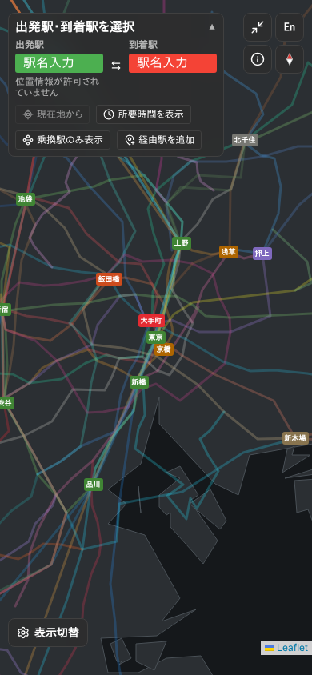
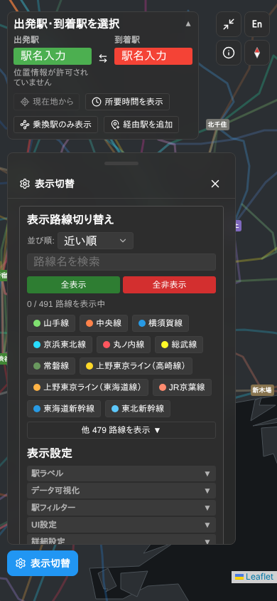
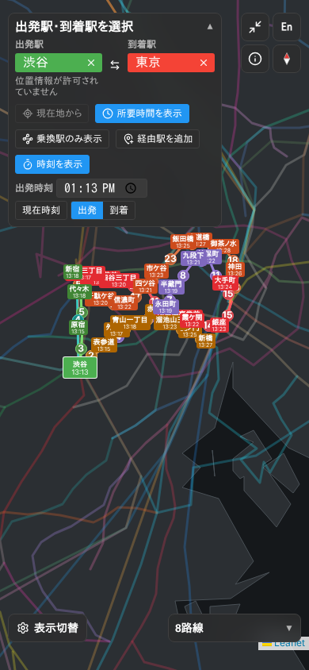
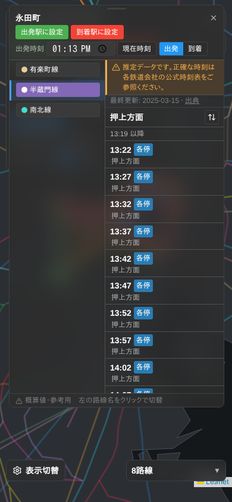

# UI の見直し（アプリ化に向けて, 2026-11）

アプリにする前に、今の Web 版の地図画面をスマホ幅で測り直した。押しにくいボタン、深すぎる階層、
見にくいデザインを網羅的に洗い出し、それぞれに「Web 版での直し方」と「アプリでの作り方」を書く。

- 測った端末: スマホ幅 390×844（iPhone 14 相当）、タッチ操作、ダークテーマ、日本語
- 測った版: `main`（2026-11-09, PR #102 まで）
- 測り方: `node scripts/audit-mobile-ui.mjs`（下の「数え直し方」）。画面写真は `docs/app/images/`
  （試験環境では外部の地図タイルを止めているため、背景の地図は写っていない）
- 基準:
  - 押せる大きさ: iOS 44pt / Android 48dp（各 OS のガイドライン）。このリポジトリの `CONTROL_SIZE.md` も 44px
  - 文字の大きさ: 12px 以上（`docs/design-system.md`）
  - コントラスト: 本文 4.5:1 以上（WCAG 2.2 AA）

## 結論（先に3行）

1. **押せるものはすべて 44px 未満。** 測った4画面で 1 つも 44px に届いていない。駅名の入力欄・入れ替えボタン・
   「出発駅に設定」など、主な操作が補助操作用の 24px（`CONTROL_SIZE.sm`）で作られている
2. **設定が1か所に積み上がっている。** 「表示切替」パネルに路線 491 本と設定約 40 項目が縦に並び、全部開くと
   9,799px（画面 11.6 枚分）。開閉は最大3段。経路の候補（所要時間・乗換回数）は既定で隠れている
3. **経路を出すと地図が読めない。** 駅名と時刻のラベルが重なり、上の駅選択の箱が画面の約3分の1を覆う

## 測った数字

| 画面 | 押せるもの | 44px 未満 | 24px 未満 | コントラスト 4.5:1 未満 |
|---|---|---|---|---|
| 最初の画面 | 27 | 27（全部） | 0 | 0 |
| 「表示切替」を開いた直後 | 69 | 69（全部） | 5 | 1 |
| 経路を出した画面（渋谷→東京） | 90 | 90（全部） | 42 | 6 |
| 駅を押した（時刻表） | 101 | 101（全部） | 45 | 8 |

- 「表示切替」の開閉: 1段目（パネルを開く）→ 2段目 6個（駅ラベル・データ可視化・複数駅の共通路線・駅フィルター・UI設定・他 479 路線）→ 3段目 1個（詳細設定）
- 全部開いたときの縦の長さ: 9,799px（画面 11.6 枚分）
- 12px 未満の文字: 地図の駅ラベル以外には無い（駅ラベルは `MAP_LABEL` の例外として 9px）

| 最初の画面 | 表示切替を開いた | 経路を出した | 駅を押した |
|---|---|---|---|
|  |  |  |  |

## 見つかったこと

重さ: **高** = 主な操作ができない・迷う / **中** = 使えるが疲れる・見落とす / **低** = 細部

### A. 押しにくい（タップ領域）

| ID | 重さ | どこ | 今 | Web 版での直し方 | アプリでの作り方 |
|---|---|---|---|---|---|
| A1 | 高 | 出発駅・到着駅の入力欄 | 110×24px | 指で押す主な操作なので `md`（44px）にする。横に並べず縦に2段 | 画面上部の検索バー（高さ 48）。押すと全画面の駅検索に移る |
| A2 | 高 | 出発・到着の入れ替え | 24×24px | 見た目は 24px のまま、押せる範囲を 44px に広げる（`TARGET.touch`） | 検索バーの右端に 48×48 |
| A3 | 高 | 駅の時刻表の「出発駅に設定」「到着駅に設定」 | 40×22px | `md` の大きさのボタンにして、横幅いっぱいに2つ並べる | 駅の下部シートの主ボタン（高さ 48、横幅いっぱい） |
| A4 | 高 | 「現在地から」「所要時間を表示」「乗換駅のみ表示」「経由駅を追加」「時刻を表示」 | 高さ 24px | 主な操作だけ残して `md` に。頻度の低いものは設定へ | 経路の結果シートの上に横スクロールのチップ（高さ 40、押せる範囲 48） |
| A5 | 中 | 「表示切替」の中の見出し（駅ラベル▼ など5つ） | 266×22px | 見出しの行を 44px にする（`DisclosureHeader` を `md` に） | 設定画面の一覧行（高さ 56） |
| A6 | 中 | 路線のチップ（491 本） | 高さ 24px | 路線の切り替えは補助操作ではないので `md` に。数が多いので下の B2 と一緒に直す | 路線シートの一覧行（高さ 56、右にスイッチ） |
| A7 | 中 | 地図右上の丸ボタン（縮小表示・言語・このサイトについて・北を上に） | 36×36px | 44px にする（`FLOATING_CONTROL` を上げる） | 48×48。言語・このサイトについては設定画面へ移す |
| A8 | 中 | パネルの閉じる（×） | 24×24px | 押せる範囲を 44px に | シートは下にスワイプで閉じる。× は 48×48 |
| A9 | 中 | 駅のアイコン | 41×32px（ズームで変わる） | 見た目はそのまま、押せる範囲を 44px に | 駅は 48 の当たり判定。近くの駅が重なるときは候補を一覧で出す |
| A10 | 低 | 時刻表の「出典」リンク | 24×16px | 行全体を押せるようにする | 情報画面の一覧行 |
| A11 | 低 | 地図の上の所要時間の数字 | 15×15px で `role="button"` `tabindex="0"` | 押しても何もしないので、読み上げ・キーボードの対象から外す（Leaflet の `keyboard: false`） | 見せるだけの描画にする |

### B. 深すぎる階層・長すぎる一覧

| ID | 重さ | どこ | 今 | Web 版での直し方 | アプリでの作り方 |
|---|---|---|---|---|---|
| B1 | 高 | 経路の候補（所要時間・乗換回数） | 既定で非表示。出すには「表示切替」→「駅フィルター」を開く →「推薦ルート選択を表示」にチェック、の3タップ。しかも「駅フィルター」の中にあるとは名前から分からない | 出発駅と到着駅が決まったら、候補の要約（所要時間・乗換回数・使う路線）を1行で常に出す。詳しい一覧は1タップで開く | 経路の結果シートの最初の段に候補を並べる（このサービスの売りの「路線図で自分で判断する」と両立させるため、地図を隠さない高さにする） |
| B2 | 高 | 「表示切替」パネル | 路線 491 本 + 設定約 40 項目が1つのパネルに縦に並ぶ。全部開くと画面 11.6 枚分 | 「路線」と「設定」を別のパネルに分ける。路線は検索と「経路に関係する路線」を先頭に、ほかは検索で探す | 地図の上に「路線」「レイヤー」の2つのボタン。設定は別画面（後述の画面構成） |
| B3 | 高 | 設定の分け方 | 「表示設定」の下に「駅ラベル」「データ可視化」「駅フィルター」「UI設定」「詳細設定」。何がどこにあるか名前から分からない（例: 経路の候補が「駅フィルター」の中） | 使う場面で分ける（地図の見た目 / 経路 / 駅 / 通知 / その他）。名前は中身を表す言葉にする | 同じ分け方で設定画面を作る。深さは最大2段（一覧 → 詳細） |
| B4 | 中 | 開閉の3段目（詳細設定） | 開閉の中にさらに開閉がある | 2段までにする。3段目の中身は2段目に平らに並べる | 設定は「一覧 → 詳細」の2段だけ |
| B5 | 中 | 全画面表示と通常表示で操作が違う | スマホは全画面が既定（`isFullscreen` の初期値 true）。全画面では左下のボタン、通常表示では別のパネルに同じ機能がある | 1つの作りにそろえる | 全画面と通常の区別を作らない（アプリは常に地図が全画面） |
| B6 | 中 | 右下の「8路線」と、パネルの中の路線一覧 | 同じ「表示中の路線」が2か所にある | 右下は要約（色の点と本数）だけにして、押すと路線パネルを開く | 路線シートに一本化 |

### C. 見にくい

| ID | 重さ | どこ | 今 | Web 版での直し方 | アプリでの作り方 |
|---|---|---|---|---|---|
| C1 | 高 | 経路を出した地図 | 駅名と時刻のラベルが重なり、線が見えない（写真「経路を出した」） | 経路上は「乗る駅・乗り換える駅・降りる駅」だけ時刻つき、途中の駅は点だけにする。重なったラベルは間引く | 同じ。拡大すると途中の駅の名前が出る |
| C2 | 高 | 上の駅選択の箱 | 経路を出すと「時刻を表示」「出発時刻」「出発/到着」まで広がり、画面の上から約 290px（3分の1）を覆う | 経路を出したら箱を1行（出発→到着・時刻）に縮める。広げるのは押したときだけ | 検索バーは1行。時刻の指定は経路の結果シートの中 |
| C3 | 中 | 低いコントラスト | 「出発駅に設定」2.8:1、「表示切替」「所要時間を表示」「時刻を表示」3.1:1、「到着駅に設定」3.7:1 | 白い文字を載せる塗りを濃くする（`filledLabelColors` の判定に通す）か、文字を黒にする | 色のトークンを書き出すときに、文字と背景の組を 4.5:1 で検査する |
| C4 | 中 | 「位置情報が許可されていません」 | 駅選択の箱の中に常に2行で出る | 「現在地から」を押したときだけ出す | 位置情報は「現在地から」を押したときに OS の許可を求める |
| C5 | 中 | 時刻表の吹き出し | 画面の高さいっぱいの吹き出しが地図を覆う。左右2列で、路線名の列が狭い | 下部シートにして、路線はタブで切り替える | 駅の下部シート（半分 → 全画面の2段階）。路線は上のタブ |
| C6 | 低 | 「左の路線名をクリックで切替」 | スマホでも「クリック」と書く | 指の端末では「タップ」と書く（`useCanHover` で分ける） | アプリの文言は「タップ」 |
| C7 | 低 | 地図の駅ラベル | 既定 9px（例外として認めている） | 今の例外は残す。経路を出したときだけ乗る駅を大きくする | 地図の文字は OS の文字の大きさ設定に合わせて大きくする（最低 11pt） |

## アプリでの画面構成（案）

地図を常に全画面にして、操作はすべて**下から出るシート**と**上の検索バー**にまとめる。深さは最大2段。

```
地図（常に全画面）
├─ 上: 検索バー（出発 → 到着）……押すと全画面の駅検索
├─ 右上: 現在地 / 北を上に
├─ 右: 「路線」「レイヤー」ボタン（48×48）
└─ 下: シート（3段階の高さ: 小 / 半分 / 全画面）
    ├─ 何も選んでいない: よく使う経路・最近の駅
    ├─ 経路を出した: 候補（所要時間・乗換・路線）→ 押すと乗り換えの詳細と時刻
    └─ 駅を押した: 駅名・「ここから」「ここまで」・路線ごとの時刻表

路線シート: 検索 + 経路に関係する路線 + 表示中 + ほか（一覧行・スイッチ）
レイヤーシート: 路線図 / 簡略図 / ヒートマップ / 立体（大きな4つのカード）
設定画面（別画面）: 地図の見た目 / 経路 / 駅 / 通知 / 言語 / このサイトについて
```

## 数え直し方

```bash
npm run build
npx astro preview --port 4392 --host 127.0.0.1 &
PW_CHROMIUM_PATH=/opt/pw-browsers/chromium node scripts/audit-mobile-ui.mjs http://127.0.0.1:4392 ui-audit-out
```

`ui-audit-out/audit.json` に、44px 未満の操作・コントラストの低い文字の一覧が出る。
Web 版を直したら数え直して、この表を書き換える。
